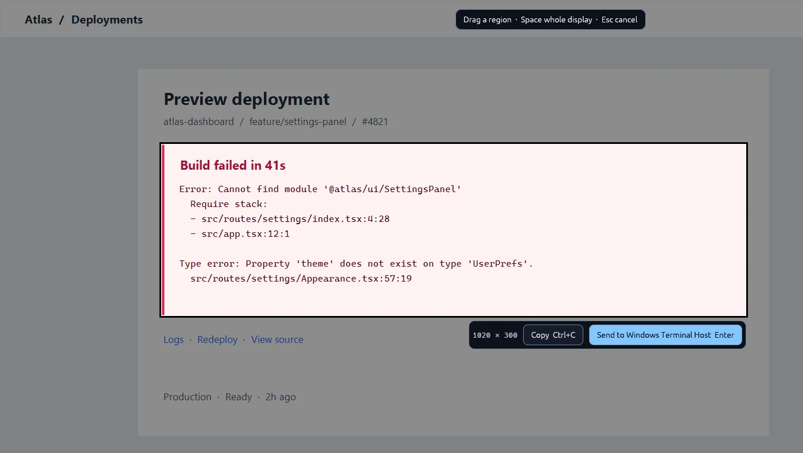

<div align="center">
  <h1> ScreenFling</h1>
  <p><strong>Show your coding agent what you see.</strong><br>
  Select part of the screen, then copy it or send it straight to your coding agent.</p>
  <p><strong>Rust</strong> · egui · SDL3 / OpenGL · Windows / macOS / Linux</p>
  <p><a href="#try-it">Build & run</a> · <a href="#how-it-is-built">How it is built</a> · <a href="docs/USAGE.md">User guide</a></p>
</div>



*The real app on Windows, over a synthetic deployment page.*

A screenshot often explains a bug faster than a paragraph. ScreenFling is a small native tool for getting one into Claude Code, Codex, OpenCode, Cursor, a browser chat, or anything else that accepts a pasted image.

## How it works

1. Anywhere, such as a browser, an app or docs, press **Ctrl+Shift+9** (**Cmd+Shift+9** on macOS). The screen freezes.
2. Drag a region, or press **Space** for the whole display.
3. Press **Enter** to **Send**: ScreenFling switches to the agent window you used last and presses its image-paste key once. **Tab** picks another open agent. Or choose **Copy** (Ctrl+C / Cmd+C) and paste it yourself.

Send never presses Enter, so you still review and submit the prompt. Agents in terminals and agent apps are both supported. Each gets the key it expects for an image: **Alt+V** in Windows terminals, **Ctrl+V** in macOS terminals, and the normal paste key in apps.

There are no agent plugins, accounts, saved screenshot files or uploads. The clipboard is the handoff. See [the user guide](docs/USAGE.md) for every key, platform limits and permissions.

## How it is built

- **One state machine.** Capturing → Selecting → Sending. Each stage owns exactly the data it needs, so a stale, cancelled or replaced image cannot be delivered. A late capture result for a cancelled capture is discarded by its generation id. [app.rs](src/app.rs)
- **One image model.** Native Windows, macOS, X11 and Wayland capture adapters produce the same RGBA pixels. A selection maps to the captured pixels using the real image size, never an assumed scale factor, so crops stay exact at fractional display scaling. [capture](src/capture/) · [model.rs](src/model.rs)
- **One verified paste.** Send ranks agent windows by the desktop's own most-recently-used order, with no background tracking. It checks that the chosen window has focus and that the clipboard still holds this image, then sends one chord and never retries. Keyboard actions wait until every key is released, so a held Enter or Ctrl+C cannot leak into your agent. [send.rs](src/send.rs) · [clipboard.rs](src/clipboard.rs)

[CI](.github/workflows/check.yml) builds and packages all three platforms. Fixtures compare every cropped pixel on X11 and Wayland at 125% scale, read the native clipboard from a separate process, and check that Send reaches only the original terminal with exactly one paste and no Enter. [Reproduce the checks](docs/DEVELOPMENT.md#checks).

## Try it

Install **Rust, CMake and a native C/C++ toolchain**, plus the [platform prerequisites](docs/DEVELOPMENT.md#build-prerequisites).

```sh
git clone https://github.com/d-sandhu/screenfling.git
cd screenfling
cargo run --release --locked
```

Keep it running in the tray, then use the shortcut from any app.

## Status

**Pre-release.** Windows has been checked end to end on a physical desktop: Send attaches the image to a real Claude Code prompt in Windows Terminal and pastes into GUI apps, and Copy and cancel work. macOS and Linux are covered by CI. What remains before v0.1.0 is in the [release checklist](docs/DEVELOPMENT.md#release-checklist).

[Development & contributing](docs/DEVELOPMENT.md) · [Report an issue](https://github.com/d-sandhu/screenfling/issues) · [MIT](LICENSE)
